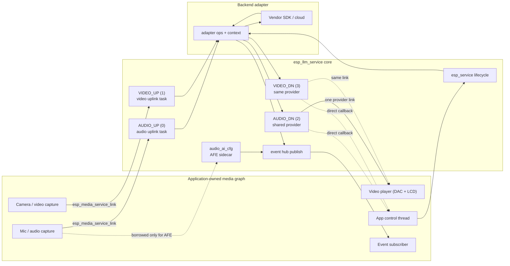
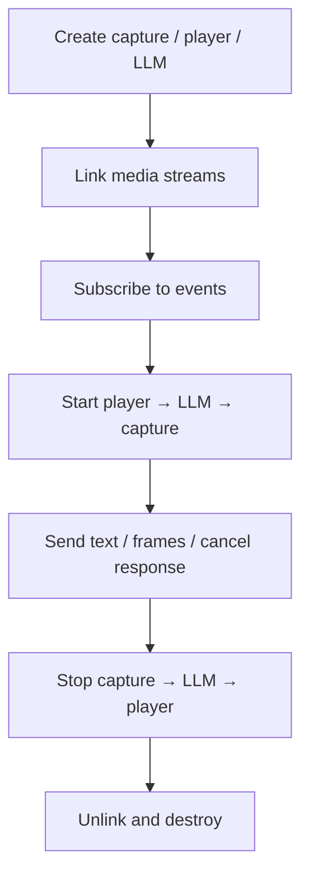

# ESP LLM Service

- [中文版](./README_CN.md)

`esp_llm_service` provides a common AI-session service for ESP-ADF.

Applications create capture and player services, configure their media streams, and link source streams to the four LLM media streams. After services are linked and started, uplink frames are consumed by the LLM and forwarded to the backend adapter; downlink frames reach the application-owned player through a provider or a direct callback. The LLM does not own capture/player objects and never creates, links, starts, stops, unlinks, or destroys them for the application.

## Features

- Unified session lifecycle through `esp_service`
- Backend adapter contract: capability bits, create/start/stop/destroy; adapters validate `cfg.streams[]`
- Four media streams: `ESP_LLM_MEDIA_STREAM_AUDIO_UP` / `VIDEO_UP` / `AUDIO_DN` / `VIDEO_DN`
- Independent audio and video uplink consume tasks (`esp_llm_common.h` / `esp_service_scheduler`)
- `esp_llm_service_enable_uplink_track()` to gate send by media type
- Shared dual-track downlink manager; one provider link to `esp_video_player_service`
- Adapters must fill downlink `frame->pts`; set `dts` to PTS or `ESP_LLM_PTS_ABSENT` when DTS is not independent
- `esp_llm_service_set_downlink_cache_size()` before link (default 16 KB audio / 128 KB video)
- `esp_llm_service_send_text()` / `send_frame()` / `send_custom_data()` / `cancel_response()`
- Common and backend-raw events through the `esp_service` event hub
- Audio AI: borrow the application's audio capture to attach AFE (VAD / WakeNet / DOA)
- `esp_llm_service_set_wakeup_cancel_response()` after create when WakeNet is enabled
- `trigger_wakeup()` / `keep_awake()` / `trigger_sleep()` for button and hold-to-talk
- MCP session tools compiled in when `ESP_LLM_SERVICE_MCP_ENABLE` is set

## Directory Structure

```
esp_llm_service/
├── include/
│   ├── esp_llm_service.h       Session lifecycle, media, control, and event API
│   ├── esp_llm_adapter.h       Backend adapter contract implemented by each vendor
│   ├── esp_llm_common.h        Shared types, PTS helpers, and capability bits
│   └── esp_llm_service_mcp.h   MCP session tools
├── private_include/            Adapter helper API shared with in-tree adapters
├── src/                        Service, media, audio AI, event, and MCP implementation
├── examples/llm_service/       Minimal service example
└── test_apps/                  Contract tests
```

Implementation and review guidance lives in [agent.md](agent.md); it covers ownership, start/stop order, the four media streams, audio AI, events, threading, and a review checklist.

## Backend Adapters

Each adapter is a separate component that implements the `esp_llm_adapter.h` contract and exposes a typed create function. Product examples live under [`adf_examples/ai_agent`](../../adf_examples/ai_agent).

| Adapter | Transport | Audio | Video uplink | Video downlink | Example |
| --- | --- | --- | --- | --- | --- |
| [esp_llm_baidu](../esp_llm_baidu) | BRTC | OPUS or PCM 16 kHz | Scene-gated camera stream or snapshot | Generated images | [esp_llm_baidu_agent_app](../../adf_examples/ai_agent/esp_llm_baidu_agent_app) |
| [esp_llm_coze](../esp_llm_coze) | WebSocket | OPUS 16 kHz | Not supported | Not supported | [esp_llm_coze_agent](../../adf_examples/ai_agent/esp_llm_coze_agent) |
| [esp_llm_tongyi](../esp_llm_tongyi) | WebSocket | OPUS 16 kHz | One-shot JPEG through `send_frame()` | Not supported | [esp_llm_tongyi_agent](../../adf_examples/ai_agent/esp_llm_tongyi_agent) |
| [esp_llm_volc](../esp_llm_volc) | Volc RTC | G.711A 8 kHz or OPUS | Supported by the adapter | Supported by the adapter | [esp_llm_volc_agent](../../adf_examples/ai_agent/esp_llm_volc_agent) |

## Architecture



## Media Streams

The LLM communicates through four stream IDs used with `esp_media_service_link()`:

```c
ESP_LLM_MEDIA_STREAM_AUDIO_UP  /* capture → LLM */
ESP_LLM_MEDIA_STREAM_VIDEO_UP  /* camera → LLM */
ESP_LLM_MEDIA_STREAM_AUDIO_DN  /* LLM → player */
ESP_LLM_MEDIA_STREAM_VIDEO_DN  /* LLM → display */
```

`esp_llm_service_cfg_t.streams[]` is the unique source of stream enable and format. Typed adapter defaults pre-fill codecs and rates; the application enables the streams it uses, then creates capture/player from the same `info`. After create, `esp_llm_service_get_stream_info()` returns those formats. Adapters validate codec/rate/channel and return `ESP_ERR_NOT_SUPPORTED` when they cannot accept a stream.

## Quick Start

Prefer a typed wrapper supplied by an adapter, such as `esp_llm_volc_create()`, `esp_llm_baidu_create()`, `esp_llm_coze_create()`, or `esp_llm_tongyi_create()`.

```c
esp_llm_volc_cfg_t cfg = ESP_LLM_VOLC_CFG_DEFAULT();
cfg.iot.product_key = "...";

const esp_media_track_info_t *audio_up =
    &cfg.service.streams[ESP_LLM_MEDIA_STREAM_AUDIO_UP].info;
const esp_media_track_info_t *audio_dn =
    &cfg.service.streams[ESP_LLM_MEDIA_STREAM_AUDIO_DN].info;

esp_capture_service_t *capture = app_create_capture(audio_up);
esp_player_service_t *player = app_create_video_player(audio_dn);

cfg.service.audio_ai_cfg.capture = capture;
cfg.service.audio_ai_cfg.feature_mask = ESP_AUDIO_CAPTURE_SERVICE_AI_FEATURE_WN;

esp_llm_service_t *llm = NULL;
ESP_ERROR_CHECK(esp_llm_volc_create(&cfg, &llm));
ESP_ERROR_CHECK(esp_llm_service_set_wakeup_cancel_response(llm, true));

ESP_ERROR_CHECK(esp_media_service_link(
    ESP_SERVICE_BASE(capture), APP_AUDIO_CAPTURE_STREAM,
    ESP_SERVICE_BASE(llm), ESP_LLM_MEDIA_STREAM_AUDIO_UP));
ESP_ERROR_CHECK(esp_media_service_link(
    ESP_SERVICE_BASE(llm), ESP_LLM_MEDIA_STREAM_AUDIO_DN,
    ESP_SERVICE_BASE(player), APP_AUDIO_PLAYER_STREAM));

esp_service_event_subscribe(ESP_SERVICE_BASE(llm), &sub);

esp_service_start(ESP_SERVICE_BASE(player));
esp_service_start(ESP_SERVICE_BASE(llm));
esp_service_start(ESP_SERVICE_BASE(capture));
```

Typical lifecycle:



`APP_AUDIO_CAPTURE_STREAM`, `APP_AUDIO_PLAYER_STREAM`, and the helper functions above are application-specific placeholders, not LLM APIs.

## Media Paths

### Uplink

Link a capture source to `AUDIO_UP` and/or `VIDEO_UP` **before start**. On LLM start, each enabled and linked uplink gets its own independent consume task. Each task acquires a frame from its provider, calls adapter `send_frame()`, and releases the frame. Linking an uplink after the service is RUNNING or in ERROR returns `ESP_ERR_INVALID_STATE`. `esp_llm_service_enable_uplink_track()` can drop send without stopping capture and is safe to call from a wake-up event handler. The gate persists across stop/start.

`esp_llm_service_send_frame()` is also available for application-pushed audio/video and one-shot vision input. Uplink `send_frame()` does not require PTS. Do not push the same streaming frames manually while a linked provider is already supplying them. IMAGE-mode backends may return `ESP_OK` while dropping video frames until they request a snapshot.

### Provider downlink

When a supported output has no direct callback configured, the LLM creates one shared track manager (audio and/or video). The application links that provider once, typically through `AUDIO_DN` (or `VIDEO_DN` when audio is unused), to a single `esp_video_player_service`:

```c
esp_media_service_link(
    ESP_SERVICE_BASE(llm), ESP_LLM_MEDIA_STREAM_AUDIO_DN,
    ESP_SERVICE_BASE(video_player), APP_VIDEO_PLAYER_STREAM);
```

Adapters must fill `frame->pts`. Use `esp_llm_pts_from_pcm()` / `esp_llm_pts_from_video_fps()`. `ESP_LLM_PTS_ABSENT` is rejected. If DTS is not independent, set `frame->dts` to PTS or `ESP_LLM_PTS_ABSENT` (the service copies PTS). A zero `dts` is a real timestamp. `ESP_MEDIA_FRAME_FLAG_KEY` marks a new TTS utterance or video stream (reset the PTS cursor). `ESP_MEDIA_FRAME_FLAG_EOS` is forwarded as an empty EOS frame. Call `esp_llm_service_set_downlink_cache_size()` before `esp_media_service_link()` if the default 16 KB / 128 KB caches are not enough. After the provider is exported, changing the cache size is rejected.

### Downlink callback tap

Set `downlink_cb` before create to observe audio and video downlink frames. It does not bypass the provider: link a player as well if frames should still play. Filter by `frame->type`.

```c
esp_llm_volc_cfg_t cfg = ESP_LLM_VOLC_CFG_DEFAULT();
cfg.service.downlink_cb = on_downlink;
cfg.service.downlink_cb_ctx = app_ctx;
```

The frame and its payload are valid only during the callback. Copy data that must outlive the call. A callback with no player link still delivers frames; `get_provider` remains available for enabled downlink streams.

## Audio AI

`esp_llm_audio_ai_cfg_t` is the only place where LLM retains an application media handle. The `capture` remains application-owned and is borrowed solely to attach AFE features and callbacks.

```c
cfg.service.audio_ai_cfg.capture = capture;
cfg.service.audio_ai_cfg.feature_mask =
    ESP_AUDIO_CAPTURE_SERVICE_AI_FEATURE_VAD |
    ESP_AUDIO_CAPTURE_SERVICE_AI_FEATURE_WN |
    ESP_AUDIO_CAPTURE_SERVICE_AI_FEATURE_DOA;
```

Start LLM before capture so AFE can attach. Stop capture before LLM so AFE can detach. Wake-up publishes `ESP_LLM_EVENT_WAKEUP` (`esp_llm_wakeup_info_t`). VAD publishes `ESP_LLM_EVENT_VAD` with an `int` AFE state. DOA is a backend-raw event named `"DOA"` whose payload is `float`. To cancel the current response on wake-up, call `esp_llm_service_set_wakeup_cancel_response(llm, true)` after create (`feature_mask` must include WakeNet). To hold microphone send closed until wake-up, call `esp_llm_service_enable_uplink_track(llm, ESP_MEDIA_TRACK_TYPE_AUDIO, false)` after create and open it from the wake-up event.

## Events

Adapters call the event dispatcher with `esp_llm_event_t`. The service deep-copies the envelope, `backend_event_name` (only when `common_id` is `ESP_LLM_EVENT_NONE`), and payload before publishing.

Subscribe with `esp_service_event_subscribe()`. The callback receives an `adf_event_t`; its `payload` is an `esp_llm_event_t`. `common_id` carries portable semantics. A raw backend event uses `ESP_LLM_EVENT_NONE` and is published under event-hub ID `ESP_LLM_EVENT_BACKEND_RAW`.

Common events include wake-up, VAD, connected, disconnected, media-ready, text, error, and interaction-finished. Audio/video downlink data does not travel as events. Empty `send_text()` / `send_custom_data()` strings return `ESP_ERR_INVALID_ARG`. `esp_llm_service_get_capabilities()` is the create-time intersection of adapter static bits and streams enabled in `cfg.streams[]`; it does not follow runtime uplink gates.

## Notes

- Call public lifecycle through `esp_service_start(ESP_SERVICE_BASE(llm))` and `esp_service_stop(ESP_SERVICE_BASE(llm))`.
- Stop capture first, then LLM, then player. `audio_ai_cfg` requires this ordering.
- `esp_llm_service_destroy()` does not stop the instance. Call `esp_service_stop()` first. It then releases the adapter and sets the handle to `NULL` on success. If an uplink task is still running, or the adapter was not released, the handle is kept for retry.
- Adapter `stop()` must silence its callbacks before returning.
- Control-plane APIs must be serialized on one application thread. `enable_uplink_track` is thread-safe and may run from an event-hub handler. Other event handlers should return quickly.
- `cancel_response` stops the current generation/TTS turn while preserving the backend connection and conversation session.
- Link every uplink before start; linking a RUNNING or ERROR service returns `ESP_ERR_INVALID_STATE`.
- Change the downlink cache size before `esp_media_service_link()`; once the provider is exported the call is rejected.

## Performance

| Item | Value |
| --- | --- |
| Downlink cache, audio | 16 KB by default, set with `esp_llm_service_set_downlink_cache_size()` |
| Downlink cache, video | 128 KB by default, set with the same API |
| Uplink tasks | One task per enabled and linked uplink stream, so at most two |
| Uplink task stack | Default 8192 bytes; tune `aud_up` / `vid_up` with `esp_service_scheduler_set_cb()` |
| Uplink task priority | Default 5; tune with the same scheduler callback |
| Uplink task core | Default 0; do not use `tskNO_AFFINITY` with PSRAM stacks |
| Uplink acquire timeout | `ESP_LLM_SERVICE_UPLINK_FRAME_TIMEOUT_MS`, default 100 ms |
| Uplink stop timeout | `ESP_LLM_SERVICE_UPLINK_STOP_TIMEOUT_MS`, default 5000 ms per task |
| Downlink track managers | One shared manager serves both audio and video downlink |
| Event publish | Envelope, backend event name, and payload are deep-copied per publish |

## SoC Compatibility

The service itself is chip-agnostic and follows the capabilities of the services it is linked to. Audio sessions need a board with `audio_adc` and `audio_dac`; video streams additionally need a camera and a display. The audio AI features depend on `esp_audio_capture_service` AFE support, and the uplink task core ID must be 0 on single-core SoCs.

The in-tree adapters are validated on ESP32-S3, ESP32-S31, and ESP32-P4. Per-adapter limits are listed in each adapter README.

## FAQ

**Why does the service not create the capture and player itself?**

Products differ in how many player streams they need, whether a camera exists, and how prompt tones are mixed. Keeping those objects in the application means one media graph serves the LLM, local prompts, and URL playback at the same time, and swapping the backend adapter does not disturb the graph.

**Why must the player start before the LLM, and capture last?**

The player must be ready before the first downlink frame arrives, and the LLM must be running before capture starts so that the AFE sidecar in `audio_ai_cfg` can attach to the capture service. Stopping runs in the reverse order so AFE can detach before capture goes away.

**Why does `esp_llm_service_get_capabilities()` not change after `enable_uplink_track()`?**

Capabilities are resolved once at create time as the intersection of the adapter's static bits and the streams enabled in `cfg.streams[]`. The uplink gate is a runtime send filter, not a change in what the session can do, so it does not rewrite the mask.

**A downlink callback is set, but nothing plays.**

The callback is a tap, not a replacement for the provider. Link a player to `AUDIO_DN` or `VIDEO_DN` as well when the frames should still be rendered.

## Technical Support

For technical support, use the links below:

- Technical support: [esp32.com](https://esp32.com/viewforum.php?f=20) forum
- Issue reports and feature requests: [GitHub issue](https://github.com/espressif/esp-adf/issues)

We will reply as soon as possible.
