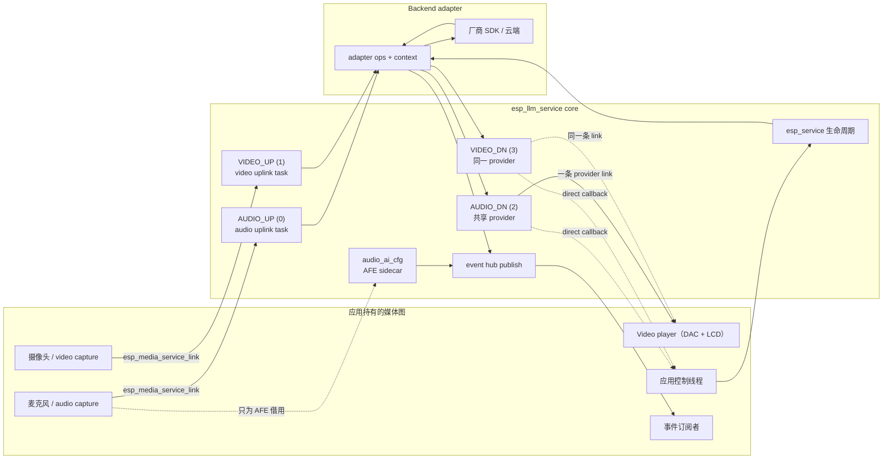
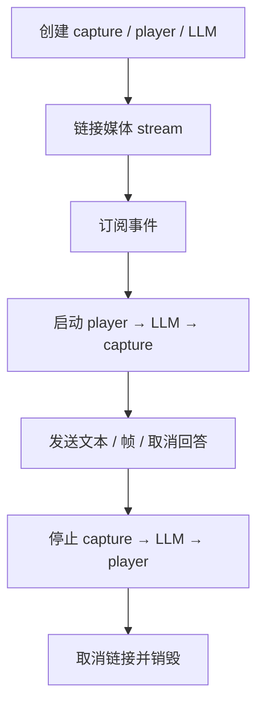

# ESP LLM Service

- [English](./README.md)

`esp_llm_service` 为 ESP-ADF 提供统一的 AI 会话服务。

应用程序创建 capture 和 player，配置媒体 stream，并将源 stream 链接到 LLM 的四条媒体流。服务链接并启动后，上行帧由 LLM 消费并交给 backend adapter，下行帧通过 provider 或 direct callback 交给应用持有的播放端。LLM 不拥有 capture/player，也不会替应用创建、链接、启动、停止或销毁它们。

## 功能特性

- 通过 `esp_service` 统一管理会话生命周期
- Backend adapter 契约：能力位、create/start/stop/destroy；adapter 校验 `cfg.streams[]`
- 四条媒体流：`ESP_LLM_MEDIA_STREAM_AUDIO_UP` / `VIDEO_UP` / `AUDIO_DN` / `VIDEO_DN`
- 独立的音视频上行消费任务（`esp_llm_common.h` / `esp_service_scheduler`）
- `esp_llm_service_enable_uplink_track()` 按媒体类型门控上送
- 共享双 track 下行 manager；应用只需把一条 provider link 接到 `esp_video_player_service`
- Adapter 必须填写下行 `frame->pts`；无独立 DTS 时把 `dts` 设为 PTS 或 `ESP_LLM_PTS_ABSENT`
- `esp_llm_service_set_downlink_cache_size()` 在 link 之前调用（默认音频 16 KB、视频 128 KB）
- `esp_llm_service_send_text()` / `send_frame()` / `send_custom_data()` / `cancel_response()`
- 通过 `esp_service` event hub 发布通用事件与 backend 原始事件
- Audio AI：借用应用 audio capture 挂载 AFE（VAD / WakeNet / DOA）
- `esp_llm_service_set_wakeup_cancel_response()` 在 create 之后、且 WakeNet 已启用时调用
- `trigger_wakeup()` / `keep_awake()` / `trigger_sleep()` 支持按键与按住说话
- 设置 `ESP_LLM_SERVICE_MCP_ENABLE` 后编译 MCP 会话工具

## 目录结构

```
esp_llm_service/
├── include/
│   ├── esp_llm_service.h       会话生命周期、媒体、控制和事件 API
│   ├── esp_llm_adapter.h       各厂商实现的 backend adapter 契约
│   ├── esp_llm_common.h        共享类型、PTS 辅助函数和能力位
│   └── esp_llm_service_mcp.h   MCP 会话工具
├── private_include/            与仓库内 adapter 共享的辅助 API
├── src/                        服务、媒体、audio AI、事件和 MCP 实现
├── examples/llm_service/       最小服务示例
└── test_apps/                  契约测试
```

实现与评审指引见 [agent.md](agent.md)，其中包含所有权、启停顺序、四条媒体流、audio AI、事件、线程契约与评审检查清单。

## Backend 适配器

每个 adapter 都是独立组件，实现 `esp_llm_adapter.h` 契约并提供 typed create 函数。产品例程位于 [`adf_examples/ai_agent`](../../adf_examples/ai_agent)。

| 适配器 | 传输 | 音频 | 视频上行 | 视频下行 | 例程 |
| --- | --- | --- | --- | --- | --- |
| [esp_llm_baidu](../esp_llm_baidu) | BRTC | OPUS 或 PCM 16 kHz | 按场景启用的相机流或抓拍 | 生成图像 | [esp_llm_baidu_agent_app](../../adf_examples/ai_agent/esp_llm_baidu_agent_app) |
| [esp_llm_coze](../esp_llm_coze) | WebSocket | OPUS 16 kHz | 不支持 | 不支持 | [esp_llm_coze_agent](../../adf_examples/ai_agent/esp_llm_coze_agent) |
| [esp_llm_tongyi](../esp_llm_tongyi) | WebSocket | OPUS 16 kHz | 通过 `send_frame()` 发送一次性 JPEG | 不支持 | [esp_llm_tongyi_agent](../../adf_examples/ai_agent/esp_llm_tongyi_agent) |
| [esp_llm_volc](../esp_llm_volc) | Volc RTC | G.711A 8 kHz 或 OPUS | 适配器支持 | 适配器支持 | [esp_llm_volc_agent](../../adf_examples/ai_agent/esp_llm_volc_agent) |

## 架构



## 媒体流

LLM 通过四个 stream ID 与 `esp_media_service_link()` 通信：

```c
ESP_LLM_MEDIA_STREAM_AUDIO_UP  /* capture → LLM */
ESP_LLM_MEDIA_STREAM_VIDEO_UP  /* camera → LLM */
ESP_LLM_MEDIA_STREAM_AUDIO_DN  /* LLM → player */
ESP_LLM_MEDIA_STREAM_VIDEO_DN  /* LLM → display */
```

`esp_llm_service_cfg_t.streams[]` 是流开关和格式的唯一来源。Typed adapter 的 DEFAULT 会预填 codec 与采样率；应用打开要用的流，再用同一份 `info` 创建 capture/player。create 之后可用 `esp_llm_service_get_stream_info()` 读回这些格式。Adapter 负责校验 codec/rate/channel，不能接受时返回 `ESP_ERR_NOT_SUPPORTED`。

## 快速开始

优先使用 adapter 提供的 typed wrapper，例如 `esp_llm_volc_create()`、`esp_llm_baidu_create()`、`esp_llm_coze_create()` 或 `esp_llm_tongyi_create()`。

```c
esp_llm_volc_cfg_t cfg = ESP_LLM_VOLC_CFG_DEFAULT();
cfg.iot.product_key = "...";

const esp_media_track_info_t *audio_up =
    &cfg.service.streams[ESP_LLM_MEDIA_STREAM_AUDIO_UP].info;
const esp_media_track_info_t *audio_dn =
    &cfg.service.streams[ESP_LLM_MEDIA_STREAM_AUDIO_DN].info;

esp_capture_service_t *capture = app_create_capture(audio_up);
esp_player_service_t *player = app_create_video_player(audio_dn);

cfg.service.audio_ai_cfg.capture = capture;
cfg.service.audio_ai_cfg.feature_mask = ESP_AUDIO_CAPTURE_SERVICE_AI_FEATURE_WN;

esp_llm_service_t *llm = NULL;
ESP_ERROR_CHECK(esp_llm_volc_create(&cfg, &llm));
ESP_ERROR_CHECK(esp_llm_service_set_wakeup_cancel_response(llm, true));

ESP_ERROR_CHECK(esp_media_service_link(
    ESP_SERVICE_BASE(capture), APP_AUDIO_CAPTURE_STREAM,
    ESP_SERVICE_BASE(llm), ESP_LLM_MEDIA_STREAM_AUDIO_UP));
ESP_ERROR_CHECK(esp_media_service_link(
    ESP_SERVICE_BASE(llm), ESP_LLM_MEDIA_STREAM_AUDIO_DN,
    ESP_SERVICE_BASE(player), APP_AUDIO_PLAYER_STREAM));

esp_service_event_subscribe(ESP_SERVICE_BASE(llm), &sub);

esp_service_start(ESP_SERVICE_BASE(player));
esp_service_start(ESP_SERVICE_BASE(llm));
esp_service_start(ESP_SERVICE_BASE(capture));
```

典型生命周期如下：



上面的 `APP_AUDIO_CAPTURE_STREAM`、`APP_AUDIO_PLAYER_STREAM` 与 helper 是应用占位符，不是 LLM API。

## 媒体通路

### 上行

把 capture source 连接到 `AUDIO_UP` 和/或 `VIDEO_UP`，必须在 start 之前完成。LLM 启动时，每条已启用且已连接的上行各自创建一条独立 consume task。任务从 provider acquire frame，调用 adapter `send_frame()`，再 release frame。RUNNING 或 ERROR 状态下再 link 上行会返回 `ESP_ERR_INVALID_STATE`。`esp_llm_service_enable_uplink_track()` 可以在不停止采集的情况下丢掉上送，并可从唤醒事件里调用。该门控跨 stop/start 保持。

应用也可以用 `esp_llm_service_send_frame()` 主动推送音频、视频或一次性 vision 图片。上行 `send_frame()` 不要求 PTS。已经由 linked provider 提供的 streaming frame 不要再手动推送。IMAGE 模式的 backend 可能在尚未请求快照时对视频帧返回 `ESP_OK` 并丢弃。

### Provider 下行

某个 adapter output 受支持且未配置 direct callback 时，LLM 创建一个共享 track manager（音频和/或视频）。应用只需 link 一次，通常走 `AUDIO_DN`（无音频时用 `VIDEO_DN`），接到单个 `esp_video_player_service`：

```c
esp_media_service_link(
    ESP_SERVICE_BASE(llm), ESP_LLM_MEDIA_STREAM_AUDIO_DN,
    ESP_SERVICE_BASE(video_player), APP_VIDEO_PLAYER_STREAM);
```

Adapter 必须填写 `frame->pts`，使用 `esp_llm_pts_from_pcm()` / `esp_llm_pts_from_video_fps()`。`ESP_LLM_PTS_ABSENT` 会被拒绝。无独立 DTS 时把 `frame->dts` 设为 PTS 或 `ESP_LLM_PTS_ABSENT`（service 会回填 PTS）。零值 `dts` 视为真实时间戳。`ESP_MEDIA_FRAME_FLAG_KEY` 标记新的 TTS 段或视频流（重置 PTS 游标），`ESP_MEDIA_FRAME_FLAG_EOS` 会转成空 EOS frame。默认 cache 为音频 16 KB、视频 128 KB，可在 `esp_media_service_link()` 之前调用 `esp_llm_service_set_downlink_cache_size()`。provider 导出之后不能再改 cache。

### Downlink callback 旁路

Create 前设置 `downlink_cb`，即可观察音频和视频下行帧。它不会绕过 provider：若仍要播放，照常 link player。用 `frame->type` 分流。

```c
esp_llm_volc_cfg_t cfg = ESP_LLM_VOLC_CFG_DEFAULT();
cfg.service.downlink_cb = on_downlink;
cfg.service.downlink_cb_ctx = app_ctx;
```

Frame 及 payload 只在 callback 调用期间有效，需要留用时由应用复制。未 link player 时 callback 仍会收到帧；已启用的下行流仍可 `get_provider`。

## 音频 AI

`esp_llm_audio_ai_cfg_t` 是 LLM 唯一保留应用媒体句柄的位置。`capture` 始终归应用所有，只为挂载 AFE feature 与 callback 而被借用。

```c
cfg.service.audio_ai_cfg.capture = capture;
cfg.service.audio_ai_cfg.feature_mask =
    ESP_AUDIO_CAPTURE_SERVICE_AI_FEATURE_VAD |
    ESP_AUDIO_CAPTURE_SERVICE_AI_FEATURE_WN |
    ESP_AUDIO_CAPTURE_SERVICE_AI_FEATURE_DOA;
```

LLM 必须先于 capture 启动，以便挂载 AFE；capture 必须先于 LLM 停止，以便拆除 AFE。唤醒会发布 `ESP_LLM_EVENT_WAKEUP`（`esp_llm_wakeup_info_t`）。VAD 发布 `ESP_LLM_EVENT_VAD`，payload 为 `int` AFE 状态。DOA 以名为 `"DOA"` 的 backend-raw 事件发布，payload 为 `float`。若要在唤醒开始时取消当前回答，create 之后调用 `esp_llm_service_set_wakeup_cancel_response(llm, true)`（`feature_mask` 必须包含 WakeNet）。若产品需要唤醒前不上送麦克风，在 create 之后调用 `esp_llm_service_enable_uplink_track(llm, ESP_MEDIA_TRACK_TYPE_AUDIO, false)`，再在唤醒事件里打开。

## 事件

Adapter 用 `esp_llm_event_t` 调用 event dispatcher。Service 会深拷贝 envelope、`backend_event_name`（仅当 `common_id` 为 `ESP_LLM_EVENT_NONE`）与 payload 后再发布。

使用 `esp_service_event_subscribe()` 订阅。Callback 收到的是 `adf_event_t`，其中 `payload` 指向 `esp_llm_event_t`。`common_id` 表示跨 backend 通用语义；原始 backend 事件把 `common_id` 设为 `ESP_LLM_EVENT_NONE`，并以 event-hub ID `ESP_LLM_EVENT_BACKEND_RAW` 发布。

通用事件包括唤醒、VAD、已连接、已断开、媒体就绪、文本、错误与本轮交互完成。音视频下行数据不走事件。空的 `send_text()` / `send_custom_data()` 返回 `ESP_ERR_INVALID_ARG`。`esp_llm_service_get_capabilities()` 是 create 时 adapter 静态能力与 `cfg.streams[]` 已启用流的交集，不随 runtime uplink gate 变化。

## 注意事项

- 公开生命周期直接调用 `esp_service_start(ESP_SERVICE_BASE(llm))` 与 `esp_service_stop(ESP_SERVICE_BASE(llm))`。
- 停止顺序：先停 capture，再停 LLM，最后停 player。`audio_ai_cfg` 也要求这一顺序。
- `esp_llm_service_destroy()` 不会停止实例，先调用 `esp_service_stop()`。成功后释放 adapter 并把 handle 置为 `NULL`。如果上行任务仍在运行，或 adapter 没有释放，handle 会保留以便重试。
- Adapter `stop()` 返回前必须静默自己的 callback。
- 控制面 API 必须由一个应用线程串行调用。`enable_uplink_track` 是线程安全的，可从 event-hub handler 调用。其他事件 handler 应尽快返回。
- `cancel_response` 只取消当前生成/TTS 回合，保留 backend 连接与对话 session。
- 所有上行必须在 start 之前 link；对 RUNNING 或 ERROR 状态的服务 link 会返回 `ESP_ERR_INVALID_STATE`。
- 下行 cache 大小要在 `esp_media_service_link()` 之前修改；provider 导出之后该调用会被拒绝。

## 性能

| 项目 | 取值 |
| --- | --- |
| 下行 cache（音频） | 默认 16 KB，用 `esp_llm_service_set_downlink_cache_size()` 调整 |
| 下行 cache（视频） | 默认 128 KB，用同一 API 调整 |
| 上行任务数 | 每条已启用且已连接的上行流一个任务，最多两个 |
| 上行任务栈 | 默认 8192 字节；用 `esp_service_scheduler_set_cb()` 调整 `aud_up` / `vid_up` |
| 上行任务优先级 | 默认 5；用同一个 scheduler 回调调整 |
| 上行任务核心 | 默认 0；PSRAM 栈不要用 `tskNO_AFFINITY` |
| 上行 acquire 超时 | `ESP_LLM_SERVICE_UPLINK_FRAME_TIMEOUT_MS`，默认 100 ms |
| 上行停止超时 | `ESP_LLM_SERVICE_UPLINK_STOP_TIMEOUT_MS`，每个任务默认 5000 ms |
| 下行 track manager | 一个共享 manager 同时服务音频和视频下行 |
| 事件发布 | 每次发布都会深拷贝 envelope、backend 事件名和 payload |

## SoC 兼容性

服务本身与芯片无关，能力取决于与之链接的各个服务。音频会话需要板级提供 `audio_adc` 和 `audio_dac`；视频流还需要相机和显示屏。Audio AI 功能依赖 `esp_audio_capture_service` 的 AFE 支持，单核 SoC 上上行任务的核心 ID 必须为 0。

仓库内的 adapter 在 ESP32-S3、ESP32-S31 和 ESP32-P4 上验证。各 adapter 的具体限制见对应的 adapter README。

## FAQ

**为什么服务不自己创建 capture 和 player？**

不同产品需要的播放器流数量不同，是否有相机、提示音如何混音也各不相同。把这些对象留在应用侧，同一张媒体图就能同时服务 LLM、本地提示音和 URL 播放，更换 backend adapter 时也不必改动媒体图。

**为什么 player 要先启动，capture 要最后启动？**

player 必须在第一帧下行数据到达之前就绪；LLM 必须在 capture 启动之前处于运行状态，`audio_ai_cfg` 中的 AFE sidecar 才能挂载到 capture 服务上。停止顺序相反，这样 AFE 能在 capture 消失前先拆除。

**为什么调用 `enable_uplink_track()` 后 `esp_llm_service_get_capabilities()` 不变？**

能力在 create 时一次性确定，是 adapter 静态能力位与 `cfg.streams[]` 已启用流的交集。上行门控只是运行期的上送过滤，并不改变会话本身能做什么，因此不会重写该掩码。

**设置了 downlink callback，但没有声音。**

Callback 是旁路，不是 provider 的替代。若仍需渲染这些帧，同样要把 player link 到 `AUDIO_DN` 或 `VIDEO_DN`。

## 技术支持

如需技术支持，请使用以下链接：

- 技术支持：[esp32.com](https://esp32.com/viewforum.php?f=20) 论坛
- 问题报告和功能请求：[GitHub issue](https://github.com/espressif/esp-adf/issues)

我们会尽快回复。
