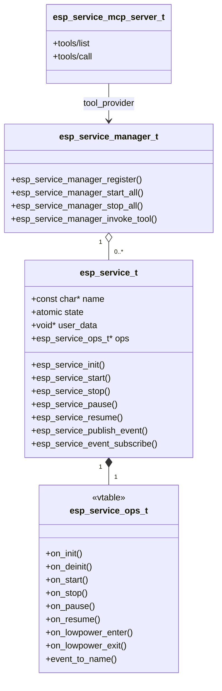
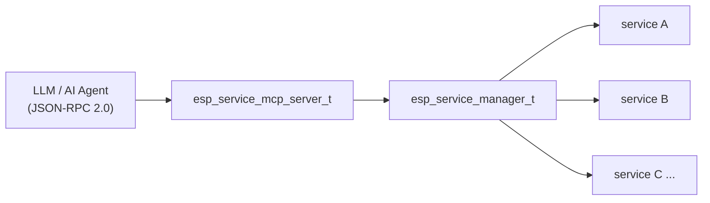
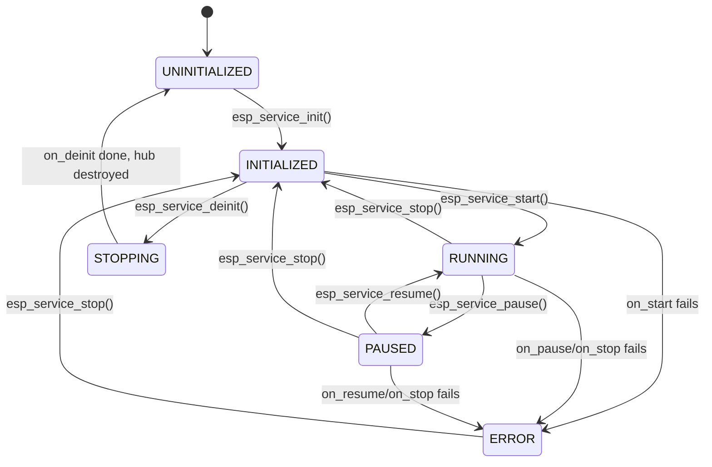

# ESP Service

- [](https://components.espressif.com/components/espressif/esp_service)
- [中文版](./README_CN.md)

**ESP Service** is a three-layer service infrastructure for ESP-IDF. It provides `esp_service_t` as the base class for services built on this layer, `esp_service_manager` as a dynamic registry that auto-discovers JSON-schema tools, and an optional MCP (Model Context Protocol) server that exposes those tools over HTTP, SSE, WebSocket, UART, STDIO, or SDIO — enabling direct invocation by LLMs and AI agents.

## Key Features

MCP request size and read-deadline settings belong to each transport; the server
has no `max_request_size` or `timeout_ms` field. The server rejects non-object
tool arguments; tool providers validate their own schema, types and ranges.
Transport and example-adapter logs omit raw request/response bodies and arguments.

Scheduler callback/context pairs are sampled under a short lock; callbacks run
outside it. Replacing or clearing a pair does not reclaim its context. Keep old
contexts alive until concurrent configuration queries finish, preferably set the
callback before service startup. Invalid thread settings are rejected without
committing callback changes.

- **Lifecycle state machine** — `UNINITIALIZED → INITIALIZED → RUNNING ⇄ PAUSED`; all transitions are synchronous in the caller's task context
- **Vtable-based subclassing** — derived services fill in `esp_service_ops_t` function pointers and embed `esp_service_t` as their first member
- **Event Hub integration** — `on_init` may register subscriptions, but the service can publish events only after initialization succeeds.
- **Low-power hooks** — `on_lowpower_enter` / `on_lowpower_exit` cause no state change; they are refused with `ESP_ERR_INVALID_STATE` on an `UNINITIALIZED` or `STOPPING` instance; suitable for suspending radios, LEDs, and clocks
- **Dynamic service registry** — `esp_service_manager` registers / unregisters services at runtime, supports batch `start_all` / `stop_all`, and looks up services by name or category
- **Automatic tool discovery** — the manager parses a JSON array at registration time and makes all described tools available via `esp_service_manager_invoke_tool()`
- **MCP server (optional)** — implements MCP 2024-11-05 (`tools/list`, `tools/call`, `notifications/tools/list_changed`) over a pluggable transport; enable with `CONFIG_ESP_MCP_ENABLE=y`
- **Multiple transports** — HTTP, SSE, WebSocket, UART, STDIO, and SDIO; each is an independent Kconfig option
- **Lifecycle and ownership** - Each instance supports a single, non-concurrent `esp_service_init()` (which zeroes the base object); `start`/`stop`/`pause`/`resume` cycles may repeat. Ordinary lifecycle operations use the instance mutex. Synchronous deinit/destroy is single-owner and forbidden inside event callbacks, workers joined by stop, and ISRs; callbacks post requests to an owner task instead. Stop external API/MCP callers, wait for in-flight calls, and unlink media endpoints first. The manager never owns services; unregister alone is not an in-flight-call barrier.
- **Synchronous reclamation** - on_stop joins asynchronous users without freeing callback-shared resources. The base cancels owned subscriptions and drains callbacks and publishes before retryable on_deinit frees private resources. Failure retains STOPPING and the object; retry resumes resource release without calling on_stop. Only success reaches UNINITIALIZED. The owner releases object storage only after deinit succeeds; user_data remains borrowed. Teardown waits without the lifecycle mutex and has no fixed time bound. Every concurrent caller must have returned before object release.
- **Manager and MCP** - The registry is mutex-protected and state is atomic. MCP server destruction stops the transport, whose stop must join request handlers. It does not automatically destroy registered services.
- **MCP teardown failures** - Stop/destroy errors retain the server, transport and handler binding for owner-task retry. Serial readers are never force-deleted; an unfinished stop rejects restart until cleanup succeeds. Bind handlers only before start or after successful stop, never concurrently with requests. Quiesce external API/broadcast callers first and clear legacy server/transport pointers only after successful destruction.

## Architecture



The three layers are independent — use only `esp_service_t` for a minimal service, add the manager for orchestration, and optionally attach the MCP server for AI-agent access.



## Service State Machine



Hooks and synchronous state notifications run outside the lifecycle lock. Overlapping lifecycle calls on the same instance return `ESP_ERR_INVALID_STATE` rather than waiting. Synchronous Event Hub callbacks must not invoke lifecycle APIs on any instance, even for a business event published outside a lifecycle operation. The callback can notify the owner task to perform the requested transition after it returns.

Calling `esp_service_deinit()` on an active or errored service stops it synchronously first (retaining `ERROR` if `on_stop` fails), then closes event admission, drains callbacks, releases the hub, and calls `on_deinit`. Calling it on `UNINITIALIZED` is an idempotent no-op. A private cleanup error leaves the service in `STOPPING` for retry.

Use one owner task for destruction: stop external callers, unlink endpoints and return borrowed deliveries/frames first. Event callbacks and this instance's lifecycle hooks must request destruction from that task, not call it themselves. `esp_service_deinit()` releases service resources, not caller-owned storage. For media objects use `esp_media_service_deinit()`. Free storage only after success; on failure retain the handle. `on_stop` joins workers but preserves callback-shared resources; `on_deinit` releases those resources after draining. `user_data` is borrowed. Live services must have unique names because equal names alias the same hub subscription owner.

## Quick Start — Subclassing

Embed `esp_service_t` as the first member, fill in `esp_service_ops_t`, call `esp_service_init()`:

```c
typedef struct {
    esp_service_t base;  /* must be first */
    /* ... derived fields ... */
} my_service_t;

static esp_err_t my_on_start(esp_service_t *base)
{
    my_service_t *svc = (my_service_t *)base;
    /* spawn background task, enable hardware, etc. */
    return ESP_OK;
}

static const esp_service_ops_t s_my_ops = {
    .on_start = my_on_start,
    .on_stop  = my_on_stop,
};

esp_err_t my_service_create(my_service_t **out_svc)
{
    my_service_t *svc = calloc(1, sizeof(*svc));
    if (!svc) { return ESP_ERR_NO_MEM; }
    esp_service_config_t cfg = { .name = "my_service" };
    ESP_ERROR_CHECK(esp_service_init(&svc->base, &cfg, &s_my_ops));
    *out_svc = svc;
    return ESP_OK;
}
```

See [`esp_ota_service`](../esp_ota_service/), [`esp_button_service`](../esp_button_service/), and [`esp_cli_service`](../esp_cli_service/) for complete subclass examples.

## Events

### Lifecycle Event

The base layer publishes `ESP_SERVICE_EVENT_STATE_CHANGED` for start/stop/pause/resume transitions, including their error transitions, but not init or teardown. Its ID is `UINT16_MAX - 1`; derived services must not use `UINT16_MAX` (wildcard) or `UINT16_MAX - 1`.

| Event | Payload | When |
|-------|---------|------|
| `ESP_SERVICE_EVENT_STATE_CHANGED` | `esp_service_state_changed_payload_t` (`old_state`, `new_state`) | Start/stop/pause/resume state changes |

### Domain Events (Subclass Pattern)

Domain events (OTA progress, button press, etc.) are published through the same event hub using `esp_service_publish_event()`. The pattern used across all services built on this layer:

1. Define an event ID enum in the public header (start from `1`; values `UINT16_MAX` and `UINT16_MAX-1` are reserved)
2. Define an event payload struct
3. Call `esp_service_publish_event()` from the service task whenever an event occurs
4. Callers subscribe with `esp_service_event_subscribe()`

```c
/* 1. Event IDs (in my_service.h) */
typedef enum {
    MY_EVENT_DONE  = 1,
    MY_EVENT_ERROR = 2,
} my_event_id_t;

/* 2. Payload */
typedef struct {
    my_event_id_t id;
    esp_err_t     error;
} my_event_t;

/* 3. Publish (inside service task) */
my_event_t *pl = malloc(sizeof(*pl));
pl->id    = MY_EVENT_DONE;
pl->error = ESP_OK;
esp_service_publish_event(&svc->base, MY_EVENT_DONE, pl, sizeof(*pl),
                          (adf_event_payload_release_cb_t)free, NULL);

/* 4. Subscribe (caller side) */
adf_event_subscribe_info_t sub = ADF_EVENT_SUBSCRIBE_INFO_DEFAULT();
sub.handler = on_my_event;
esp_service_event_subscribe((esp_service_t *)svc, &sub);
```

> **Payload ownership:** after `esp_service_publish_event()` returns, the caller must not access `pl` — `release_cb` (here `free`) is called exactly once on every path, including error paths.

## Service Manager

### Configuration

Initialize with `ESP_SERVICE_MANAGER_CONFIG_DEFAULT()` and override only what you need.

| Field | Type | Description | Default |
|-------|------|-------------|---------|
| `max_services` | `uint16_t` | Maximum registered services | `16` |
| `max_tools_per_service` | `uint16_t` | Maximum tools parsed from one JSON descriptor | `32` |
| `auto_start_services` | `bool` | Start each service immediately on registration | `false` |

### Registration

| Field | Type | Description |
|-------|------|-------------|
| `service` | `esp_service_t *` | Service instance. Required. |
| `category` | `const char *` | Category string for `find_by_category` queries (e.g. `"audio"`). |
| `flags` | `uint32_t` | `ESP_SERVICE_REG_FLAG_SKIP_BATCH_START/STOP` to exclude from batch ops. |
| `tool_desc` | `const char *` | JSON array of MCP tool definitions. `NULL` = lifecycle-only. |
| `tool_invoke` | `esp_service_tool_invoke_fn_t` | C dispatch for tool calls. Required when `tool_desc` is set. |

### Tool Description Format

```json
[
  {
    "name": "player_service_play",
    "description": "Start audio playback",
    "inputSchema": { "type": "object", "properties": {} }
  },
  {
    "name": "player_service_set_volume",
    "description": "Set playback volume (0–100)",
    "inputSchema": {
      "type": "object",
      "properties": {
        "volume": { "type": "integer", "minimum": 0, "maximum": 100 }
      },
      "required": ["volume"]
    }
  }
]
```

## Optional Features

### MCP Server (`CONFIG_ESP_MCP_ENABLE=y`)

Implements MCP 2024-11-05 over a pluggable transport. Connect it to the manager via `esp_service_manager_as_tool_provider()`.

| Field | Type | Description |
|-------|------|-------------|
| `transport` | `esp_service_mcp_trans_t *` | Pre-created transport instance. Required. |
| `tool_provider` | `esp_service_mcp_tool_provider_t` | Populated by `esp_service_manager_as_tool_provider()`. |
| `server_name` | `const char *` | Server identity string in MCP `initialize` response. |
| `server_version` | `const char *` | Server version string. |

### Available Transports

| Transport | Kconfig | Header |
|-----------|---------|--------|
| HTTP (`POST /mcp`) | `CONFIG_ESP_MCP_TRANSPORT_HTTP` | `esp_service_mcp_trans_http.h` |
| SSE (streaming) | `CONFIG_ESP_MCP_TRANSPORT_SSE` | `esp_service_mcp_trans_sse.h` |
| WebSocket | `CONFIG_ESP_MCP_TRANSPORT_WS` | `esp_service_mcp_trans_ws.h` |
| UART | `CONFIG_ESP_MCP_TRANSPORT_UART` | `esp_service_mcp_trans_uart.h` |
| STDIO | `CONFIG_ESP_MCP_TRANSPORT_STDIO` | `esp_service_mcp_trans_stdio.h` |
| SDIO | `CONFIG_ESP_MCP_TRANSPORT_SDIO` | `esp_service_mcp_trans_sdio.h` |

### Supported ESP-IDF Versions

During development and testing, select the in-tree `esp_service` directly from the application's `main/idf_component.yml` with `override_path` and no version constraint, as in `test_apps`. Keep published dependency version ranges unchanged.

WebSocket handshake behavior depends on ESP-IDF capabilities. Releases with both handshake callbacks (`CONFIG_HTTPD_WS_PRE_HANDSHAKE_CB_SUPPORT` and `CONFIG_HTTPD_WS_POST_HANDSHAKE_CB_SUPPORT`, v5.5.5+ and v6.0.1+) answer the upgrade without calling the URI handler: the bearer and `Origin` checks run from the pre-handshake callback and the client is registered for `broadcast()` from the post-handshake callback. Releases with only the pre-handshake callback (v5.4.3, v5.5.2–v5.5.4, v6.0) still call the URI handler for the handshake GET, which registers the client. v5.5.0 and v5.5.1 have neither callback and call the handler only after the `101` is sent, so the checks cannot reject an upgrade; `esp_service_mcp_trans_ws_start()` returns `ESP_ERR_NOT_SUPPORTED` there unless `auth_token` is unset and `enable_cors` is true. The UART and SDIO transports require the `esp_driver_uart` and `esp_driver_sdio` components, which exist from v5.3.

`esp_http_server` is a public dependency because the HTTP/SSE/WS headers expose
`httpd_handle_t`. Fully removing transport dependencies when MCP is disabled is
separate work; the current base component does not promise that pruning.

## Typical Scenarios

- **Service base only** — implement `esp_service_ops_t` and embed `esp_service_t` to get lifecycle management and event publishing without any manager or MCP overhead
- **Runtime service orchestration** — register multiple services with `esp_service_manager` and drive them through `start_all` / `stop_all`; the CLI service uses the manager for its `svc` commands
- **LLM tool gateway** — attach an MCP server to the manager so that any service with a JSON tool description becomes directly callable by an LLM or AI agent over HTTP/WebSocket/UART
- **Offline / embedded AI agent** — use UART or SDIO transport to connect a host-side model to device services without a network stack

## Example Projects

- [`components/esp_service/examples/mock_services/`](examples/mock_services/) — service manager + all MCP transport variants with host-side Python test scripts
- [`adf_examples/services_hub/`](../../adf_examples/services_hub/) — production-style multi-service setup (Wi-Fi + OTA + CLI + button) with `esp_board_manager` and optional MCP integration
